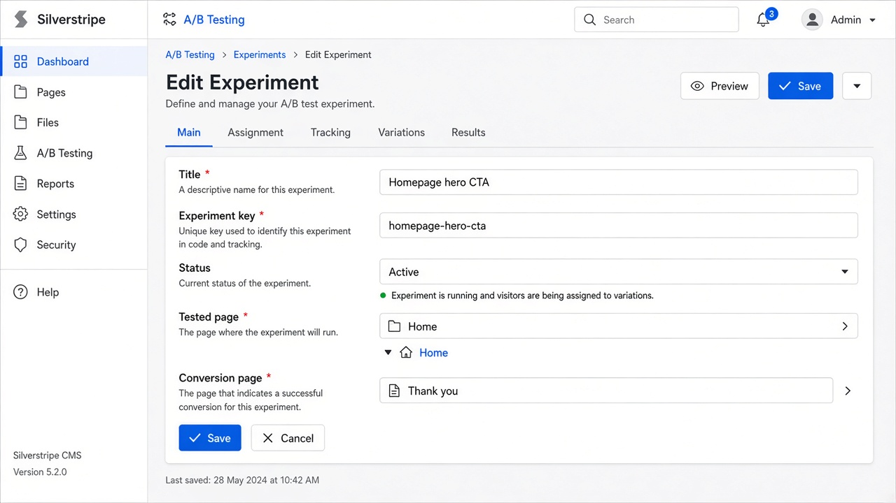
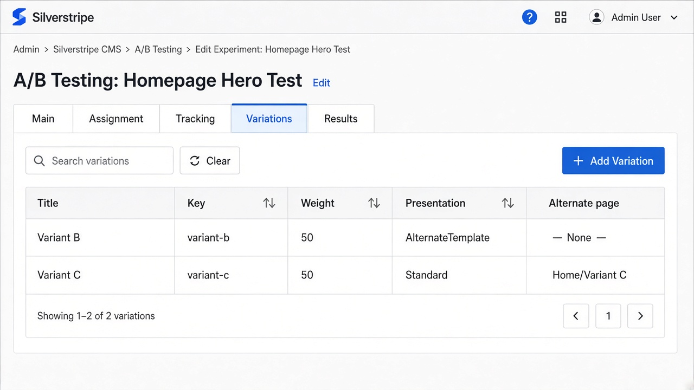
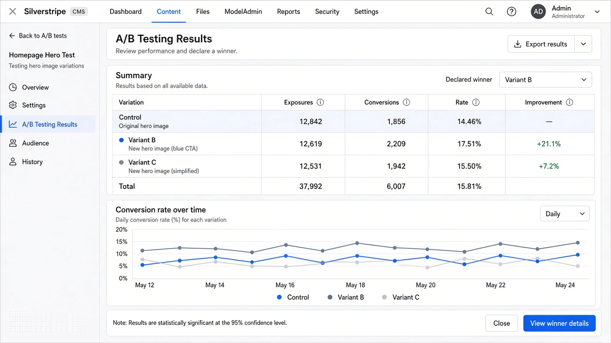

# Silverstripe A/B Testing

Run page-level A/B (and multivariate) experiments in [Silverstripe CMS 6](https://www.silverstripe.org/). Assign visitors to weighted variations, measure conversions in the CMS, push events to the Google `dataLayer`, and forward the same canonical payload to any other analytics or CDP endpoint through a pluggable tracking API.



## Requirements

- PHP 8.3+
- Silverstripe CMS 6
- `symbiote/silverstripe-gridfieldextensions` ^5

## Installation

```bash
composer require fullscreeninteractive/silverstripe-abtesting
```

Then run a rebuild:

```bash
vendor/bin/sake db:build --flush
```

The module registers itself via Composer autoload and YAML config. No `Page.php` edits are required.

## Features

- **CMS experiment manager** under *A/B Testing*
- **Weighted variations** plus a control arm
- **Traffic enrolment %** so you can ramp an experiment gradually
- **Cookie or session** persistence for assignments
- **QA override** via query string (default `?abv=variant-b`)
- **Content variation** by alternate (usually hidden) page
- **Template variation** via alternate layout templates
- **Conversion pages** at experiment or per-variation level
- **Custom conversions** from JS, forms, or server code
- **Google dataLayer** exposure + conversion events
- **Webhook / bridge API** for Segment, GA4 Measurement Protocol, custom CDPs, etc.
- **CMS reporting** with summary table and Chart.js trends
- **Raw data export** of visitor exposures/conversions
- **Page CMS tab** listing experiments that touch a page



## Quick start

1. Open **A/B Testing → Experiments** and create an experiment.
2. Set **Tested page** (where visitors are split) and optional **Conversion page**.
3. On **Variations**, add one or more variants:
   - **Alternate page** for different content (same URL)
   - **Alternate template** for different layout
4. Tune weights / enrolment on **Assignment**.
5. Confirm dataLayer / webhook settings on **Tracking**.
6. Switch **Status** to `Active`.

Visitors hitting the tested page are enrolled, assigned a variation, recorded as an exposure, and (by default) pushed into `window.dataLayer`.



## Variation strategies

| Goal | How |
| --- | --- |
| Different copy / images | Create a hidden child page and set it as the variation **Alternate page** |
| Different template | Set presentation to `AlternateTemplate` and enter template names, e.g. `HomeVariant,Page` |
| Both | Combine alternate page + alternate template on the same variation |
| QA a specific arm | Visit `https://example.org/page?abv=variant-b` |

The public URL always stays on the tested page — alternate page fields are copied into the request at runtime so navigation/menus keep working.

## Google dataLayer

When **Push events to Google dataLayer** is enabled (default), exposures and conversions push:

```js
window.dataLayer = window.dataLayer || [];
window.dataLayer.push({
  event: 'ab_test_exposure', // or ab_test_conversion
  ab_experiment_id: 12,
  ab_experiment_key: 'homepage-hero-cta',
  ab_experiment_name: 'Homepage hero CTA',
  ab_variation: 'variant-b',
  ab_variation_name: 'Variant B',
  ab_is_control: false,
  ab_event_id: 'a1b2c3d4e5f60718'
});
```

Event names are configurable:

```yaml
FullscreenInteractive\ABTesting\Bridge\DataLayerBridge:
  event_exposure: ab_test_exposure
  event_conversion: ab_test_conversion
```

Use these events as Google Tag Manager triggers for GA4, Ads, or Floodlight tags.

## Frontend helpers

The module exposes `window.SSABTesting`:

```js
// Current assignment on an experimented page
console.log(SSABTesting.assignment);

// Custom conversion (form submit, CTA click, etc.)
SSABTesting.trackConversion('homepage-hero-cta', {
  assertiveness: 100,
  custom: { source: 'signup-form' }
});

// Listen locally
SSABTesting.onEvent(function (type, detail) {
  console.log(type, detail);
});
```

Or declare a conversion in markup:

```html
<button type="button" data-ab-convert="homepage-hero-cta">Buy now</button>
```

## Tracking API (any third party)

Every exposure/conversion is built into one canonical JSON payload and sent through **tracking bridges**.

### Canonical payload

```json
{
  "event_type": "exposure",
  "event_id": "a1b2c3d4e5f60718",
  "timestamp": "2026-10-12T20:15:30+00:00",
  "experiment": {
    "id": 12,
    "key": "homepage-hero-cta",
    "title": "Homepage hero CTA",
    "status": "Active"
  },
  "variation": {
    "key": "variant-b",
    "title": "Variant B",
    "is_control": false
  },
  "page": {
    "id": 4,
    "url": "https://example.org/home"
  },
  "visitor": {
    "id": "9f8e7d6c5b4a3210"
  }
}
```

Inspect the schema live at `/abtesting/eventschema`.

### Built-in bridges

1. **DataLayerBridge** — browser `dataLayer.push`
2. **WebhookBridge** — HTTP POST JSON to one or more HTTPS endpoints

Global webhooks:

```yaml
FullscreenInteractive\ABTesting\Bridge\WebhookBridge:
  endpoints:
    - 'https://hooks.example.org/ab-events'
  timeout: 5
```

Per-experiment webhooks can also be set in the CMS **Tracking** tab.

### HTTP endpoints

| Method | Path | Purpose |
| --- | --- | --- |
| `GET` | `/abtesting` | Discovery |
| `GET` | `/abtesting/assignment?experiment=homepage-hero-cta` | Current visitor assignment |
| `POST` | `/abtesting/convert` | Record a conversion for the current visitor |
| `GET` | `/abtesting/eventschema` | Payload schema |

`POST /abtesting/convert` body:

```json
{
  "experiment": "homepage-hero-cta",
  "assertiveness": 100,
  "custom": { "plan": "pro" }
}
```

### Custom bridge

Implement `TrackingBridgeInterface` and register it:

```php
namespace My\App;

use FullscreenInteractive\ABTesting\Bridge\TrackingBridgeInterface;

class SegmentBridge implements TrackingBridgeInterface
{
    public function track(array $payload): void
    {
        // forward $payload to Segment, RudderStack, etc.
    }
}
```

```yaml
FullscreenInteractive\ABTesting\Service\TrackingService:
  bridges:
    - FullscreenInteractive\ABTesting\Bridge\DataLayerBridge
    - FullscreenInteractive\ABTesting\Bridge\WebhookBridge
    - My\App\SegmentBridge
```

## Server-side usage

```php
use FullscreenInteractive\ABTesting\Model\ABTestExperiment;
use FullscreenInteractive\ABTesting\Service\ExperimentTracker;
use FullscreenInteractive\ABTesting\Service\TrackingService;

$experiment = ABTestExperiment::get()->find('Key', 'homepage-hero-cta');
$tracker = ExperimentTracker::create();
$data = $tracker->hitConversion($experiment, $request);

if ($data) {
    TrackingService::create()->trackConversion(
        $experiment,
        $data->VariationKey,
        ['visitor_id' => $data->VisitorID]
    );
}
```

Templates can read the active assignment:

```ss
<% if $ABTestAssignment %>
  <body data-ab-variation="$ABTestAssignment.variation_key">
<% end_if %>
```

## Development

```bash
composer install
composer lint
composer test
```

GitHub Actions runs PHPUnit on PHP 8.3/8.4 and PHPCS (PSR-12).

## Migrating from the legacy module

This package replaces the pre-Composer `abtesting` module:

- Classes moved to the `FullscreenInteractive\ABTesting` namespace
- Table names (`ABTestExperiment`, `ABTestVariation`, `ABTestData`) are preserved
- `StateVariableValue` / `PHPSessionID` columns remain for upgrade safety; new code writes `VariationKey` / `VisitorID`
- Dynamic Templates support was removed (module unmaintained); use alternate pages/templates instead
- Status values are now `Draft`, `Active`, `Paused`, `Complete`

After upgrading, run `db:build` and re-activate experiments intentionally.

## Maintainers

- Fullscreen Interactive — https://www.fullscreen.io
- Originally created by Mark Stephens (Silverstripe)

## License

BSD-3-Clause. See [LICENSE](LICENSE).
